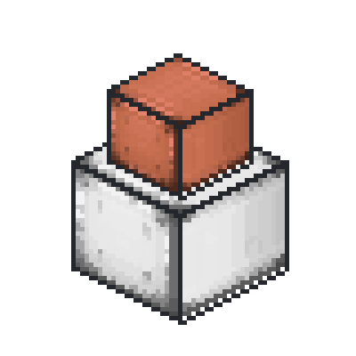

<p align="center">
  
</p>

<h1 align="center">Create: Bigger Storage Continued</h1>

<p align="center">
  <strong>English</strong> | <a href="README.zh-CN.md">简体中文</a>
</p>

An unofficial continuation of [Create: Bigger Storage](https://github.com/LopyLuna/Create-Bigger-Storage) by LopyLuna, adding tiered horizontal and vertical vaults, in-place structure upgrades, and inventory performance improvements to Create.

This project is not affiliated with or endorsed by LopyLuna or the Create team.

<p align="center">
  <a href="https://github.com/yunluoxincheng/create-bigger-storage-continued/releases">Downloads</a> · <a href="CHANGELOG.md">Changelog</a> · <a href="https://github.com/yunluoxincheng/create-bigger-storage-continued/issues">Report an issue</a>
</p>

## Downloads

- **Stable — 1.1.2:** [Download for Create 6.0.4](https://github.com/yunluoxincheng/create-bigger-storage-continued/releases/tag/v1.1.2).
- **Beta — 1.2.1:** [Downloads for Create 6.0.6–6.0.8](https://github.com/yunluoxincheng/create-bigger-storage-continued/releases), with Flywheel 1.0.5 included.

GitHub Releases is the current distribution channel. Modrinth and CurseForge publication is planned.

## Features

- **Tiered storage:** nine material tiers of horizontal vaults, plus matching vertical vaults.
- **Structure upgrades:** 45 upgrade components covering every upward combination across the nine material tiers and Create's standard tier. Upgrade a formed vault by right-clicking any member block.
- **Inventory preservation:** upgrades retain stored items and their NBT, block positions, orientation and structure dimensions. An upgrade is rejected if the target cannot hold the existing inventory.
- **Orientation recipes:** 18 conversion recipes switch between horizontal and vertical vault items while preserving their item NBT.
- **Inventory performance:** coalesced inventory notifications, cached comparator readings, and reduced client inventory synchronization. Version 1.2.1 combines direct slot lookup, incremental stock summaries and deferred independent copying for large vaults.
- **Create-style visuals:** material-colored panels and frames, translucent blue crystal vaults, and native 16×16 component icons.
- **Localization:** English and Simplified Chinese.

### Storage tiers

Capacity below is measured in inventory slots **per block**. Horizontal and vertical vaults use the same tier capacities and upgrade components.

| Tier | Wooden | Standard Create | Copper | Iron | Emerald | Gold | Crystal | Diamond | Obsidian | Netherite |
|---|---:|---:|---:|---:|---:|---:|---:|---:|---:|---:|
| Slots per block | 10 | 20* | 30 | 40 | 50 | 60 | 70 | 80 | 90 | 100 |

*The standard tier follows Create's server configuration; 20 is its default. The standard vertical silo is supplied by the optional Create: Connected mod.*

## Requirements and compatibility

| Mod version | Status | Minecraft | Forge | Create | Java |
|---|---|---|---|---|---|
| 1.2.1 | Beta | 1.20.1 | 47.4.10+ (47.x) | 6.0.6, 6.0.7, 6.0.8 | 17 |
| 1.2.0 | Beta | 1.20.1 | 47.4.10+ (47.x) | 6.0.6, 6.0.7, 6.0.8 | 17 |
| 1.1.2 | Stable | 1.20.1 | 47.2.32+ (47.x) | 6.0.4 | 17 |
| 1.1.1 | Stable, older release | 1.20.1 | 47.2.32+ (47.x) | 6.0.4 | 17 |

Version 1.2.1 uses one installer for all three listed Create versions and includes **Flywheel 1.0.5**. No separate Flywheel download is required. It remains a beta release; the completed checks and outstanding gameplay verification are documented in the [compatibility notes](docs/COMPATIBILITY.md).

**Create: Connected is optional.** It is needed only for the standard-tier vertical silo and upgrades involving that tier. Choose a Connected release compatible with your Minecraft and Create versions; its current upstream compatibility table lists Create 6.0.6 as unsupported. See [Connected's compatibility information](https://github.com/hlysine/create_connected#download).

This version line targets **Minecraft 1.20.1 / Forge**. Other Minecraft versions and loaders are outside its supported range.

## Installation

1. Install the Minecraft, Forge, Create and Java versions listed above for your chosen release.
2. Download the runtime JAR from [GitHub Releases](https://github.com/yunluoxincheng/create-bigger-storage-continued/releases) and place it in the instance's `mods` folder. The `-sources.jar` is for development.
3. Install the same version on the client and server. Stop both before replacing an older JAR, and back up the world before updating.
4. Keep only one mod using the `create_bs` ID. This continuation replaces the original Bigger Storage; do not load it alongside the original mod or the `createbiggerstoragetocreate6` bridge patch.

## Using upgrades

Craft an upgrade component for the vault's current and target tiers, then right-click any block in the formed structure. In survival, one component is required **per block**; components are collected from the player's inventory. Creative mode does not consume them.

Upgrades must be performed by a player on a stationary world structure. Deployer upgrades and upgrades on moving contraptions are not supported. Components can also be crafted into higher-target upgrades before use. See the [recipe and cost reference](docs/UPGRADES.md) for the complete crafting routes.

## Reporting issues

Use the [issue tracker](https://github.com/yunluoxincheng/create-bigger-storage-continued/issues) for bugs and feature requests. Include your mod, Minecraft, Forge and Create versions, steps to reproduce, and relevant logs or screenshots. For storage performance issues, include the vault dimensions and the terminal or automation mods involved.

Development candidates support manual inventory diagnostics with `/create_bs diagnostics start` and `/create_bs diagnostics stop`. See the [commands and counter reference](docs/TECHNICAL_NOTES.md#manual-vault-diagnostics). These commands are not included in published 1.2.0 JARs.

## Building from source

Use **Java 17** and the included **Gradle 8.12 Wrapper**. On Windows:

```powershell
.\gradlew.bat --no-daemon jarJar sourcesJar
```

On Linux or macOS:

```bash
bash ./gradlew --no-daemon jarJar sourcesJar
```

Artifacts are written to `build/libs/`. For 1.2.0, the ordinary versioned JAR includes Flywheel; the `-unbundled.jar` is an internal build artifact. Normal builds use committed resources. See the [release guide](docs/RELEASING.md) for publishing and local build options.

## Credits and license

- **LopyLuna:** original Bigger Storage project and code.
- **simibubi and the Create contributors:** Create and the source vault artwork.
- **Jozufozu and the Flywheel contributors:** the included Flywheel library and its upstream fixes.
- **Continued contributors:** maintenance, vertical vaults, upgrades and performance improvements.

Code is distributed under the [MIT license](LICENSE). Create artwork adaptations and the embedded Flywheel library retain their original notices. See [attribution and asset sources](docs/ATTRIBUTION.md) for notices, provenance and platform publication requirements.

Documentation: [upgrades](docs/UPGRADES.md), [compatibility](docs/COMPATIBILITY.md), [technical notes](docs/TECHNICAL_NOTES.md), [releasing](docs/RELEASING.md), and [attribution](docs/ATTRIBUTION.md).
